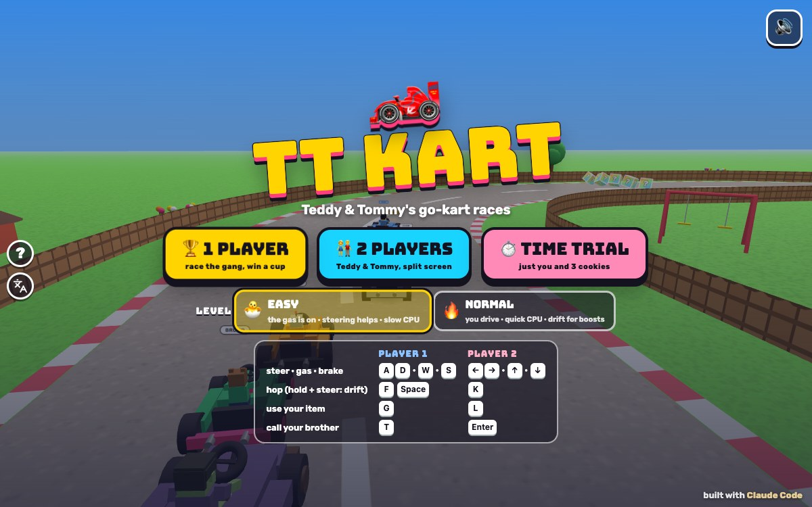

# TT Kart

[](https://adong.github.io/kart-tt/)

Press **?** any time (or tap the round **?** button on the left edge) to see the keys. The game waits while you look.
Tap the language button under it (the A文 icon) to switch between English and 中文; the dashboard and every game remember the choice.

Go-kart races starring Teddy and Tommy: six cartoon tracks with ramps, shortcuts and silly things in the way, item boxes, a Grand Prix with a trophy, split-screen for two and a time trial.

**中文：** Teddy 和 Tommy 的卡丁车比赛：六条卡通赛道，有跳台、近路和搞笑的障碍，还有道具箱、奖杯大奖赛、上下分屏双人和计时赛。

A 3D kart racer for the boys, built with Claude Code from plain JavaScript and Three.js on the shared Claude Games kit. The drivers are the kit's blocky characters sitting in chunky go-karts; there are no image, model or audio files: every texture is painted on a canvas and every sound is synthesised. Nothing is a copy of a famous kart game: the tracks, items and names are our own.

The name is a working title. It lives in one constant, `KART.TITLE` in `js/title.js`; the page title, the logo, the ? panel and the arch over the start line read it from there.

## Play

- **Double-click `index.html`.** It works offline because Three.js and the kit are copied into `kit/`. Without internet the title font falls back to Arial Black.
- **Send one file:** `dist/kart-tt.html` is the whole game in one page, about 880 KB. AirDrop or email it, then open it in a browser.
- Rebuild that file after any edit: `python3 kit/tools/bundle.py . --name kart-tt`

### A race

- **Three laps,** seven karts: the whole gang races (Teddy, Tommy, Zoom, Luna, Bolt, Bruno and the zombie), so in 1 player you race the other six.
- **3, 2, 1, GO!** The camera swings round from the front of your kart to behind it while it counts down.
- **On screen:** your lap and time (top left), your item (top middle), a little map with everyone on it (top right) and your place (bottom right, gold when you're first).
- **Going the wrong way** shows ↩ WRONG WAY. If a kart ever gets stuck or lost, a 🎈 balloon lifts it back onto the road ("UP YOU GO!").
- **After the finish** your kart does a victory lap with the camera swinging round it, then the results: everyone's place and time (and Grand Prix points).

**Levels:**

- **🐣 EASY** (the default, for Tommy, 5): **the gas is always on**, and **the steering helps**: let go and the kart follows the road by itself (round the posts and puddles too), and it steers you back before you run off the edge. The CPUs are slower and wait up for you, but the ones behind keep close, so it's a race, not a parade. If you're behind, your kart gets a little faster (catch-up help), and item boxes give more 🍪 cookies. Spins are shorter.
- **🔥 NORMAL** (for Teddy, 8): you press the gas, steer and brake yourself, the CPUs are quick and aim their items, and drifting is how you go faster.

## Controls

| | Player 1 | Player 2 | Touch |
|---|---|---|---|
| steer | A D | ← → | hold ◀ or ▶ on the bar |
| gas · brake | W · S | ↑ · ↓ | the gas is always on · 🛑 |
| hop (hold it and steer in a bend: drift) | F or Space | K | 🦘 HOP |
| use your item | G | L | 🎁 (it shows your item) |
| call your brother | T | Enter | tap his face |
| pause · sound | P or Esc · M | | ❚❚ · 🔊 |

- **Drifting:** press hop while you steer in a bend, and keep holding it: the kart slides round with sparks under the back wheels, white, then **blue**, then **orange**. Let go for a boost: a short one after blue, a big one after orange. Steering into the drift charges it faster.
- **Tricks:** press hop in the air off a ramp (or the trampoline) and your kart does a spin: land and you get a boost. "TRICK! ⭐"
- In 1 player both sets of keys work, so the arrows, K, L and Enter work too.
- **Touch:** the buttons show up on phones and tablets (add `?touch=1` to the address to see them on a computer). The gas is always on with touch. In 2 players on one iPad, each half of the screen (top for Player 1, bottom for Player 2) has its own steering bar and buttons.
- **Menus:** on the title screen Enter or 1 is 1 player, 2 is 2 players, 3 is the time trial and E switches the level. On the pick screen ← → (or A D) change Player 1's driver, Enter goes, Esc goes back; results: Enter for the next race.

## Tracks

Six tracks, each with a ramp or two, boost arrows, item-box rows, a **shortcut** that cuts across a big bend, and silly things in the way. Bumping into a post bounces you; anything rolling across the road spins you round (dizzy stars, no crashes); puddles slow you down.

| Track | What's there | Shortcut |
|---|---|---|
| 🏡 **BACKYARD** | lawn, wooden fence, houses, a swing set, a sandbox and a doghouse; a **trampoline** that bounces you sky-high; garden gnomes; a soccer ball rolling across | **the garden path** (dirt, with a little ramp) |
| 🚇 **SUBWAY** | a tiled tunnel with pillars, ceiling lights and parked trains (a nod to Metro Surfer); a chicane; traffic cones; suitcases rolling across | **the service tunnel** |
| 🏖️ **BEACH** | palm trees, umbrellas, towels, a lifeguard tower and the sea; sandcastles; a beach ball and a crab scuttling across; sand patches; a hump | **the splashy shallows** (water, with a boost arrow) |
| 🏔️ **SNOWY HILL** | it climbs up the hill and races back down; pine trees, cabins, snowmen; **icy patches** where the kart slides; a giant snowball rolling across | **the ski jump** |
| 🍭 **COOKIE LAND** | a chocolate road with sprinkles, candy-cane fences, lollipops, cupcakes, gumdrop trees and a cookie house; a trampoline; gumdrops; chocolate puddles; a rolling donut | **the cookie crumble** |
| 🌃 **NIGHT CITY** | night, stars, lit-up windows, street lamps and neon signs; right-angle corners round the blocks; taxis crossing | **the alley** round a city block |

The shortcuts are narrow and a bit slower to drive on (dirt, water, snow, cookie), but much shorter: a 🍪 cookie on a shortcut is the fastest way round. The CPUs take them now and then (more on Normal).

## Items

Drive through the rainbow **?** boxes to get an item; it spins for a second in the item box, then it's yours. What you get depends on your place: the leader gets more bananas and shields, the back of the pack more cookies and basketballs. All of them are silly and safe.

- **🍌 Banana peel:** dropped behind you. Whoever drives over it spins round with dizzy stars.
- **🏀 Basketball** (Teddy's): it bounces down the road after the kart just ahead of you and bonks it into a spin.
- **✌️ Peace shield** (Tommy's): a rainbow bubble round your kart for 9 s that stops the next hit. "BLOCKED! ✌️"
- **🍪 Turbo cookie:** a big boost, even on grass.
- **🫧 Bubble:** it floats down the road and catches the first kart it touches, which floats up in a bubble for a moment, then pops back down.

The time trial has no item boxes: you start with **🍪 × 3**.

## Call your brother (companion mode)

Call the other brother (`Kit.roster.buddyFor`: Tommy for everyone, Teddy when you drive Tommy) with **T** (Player 2: **Enter**), by tapping his face button, or by clicking his face under your lap time, **as often as you like**: there's no waiting, so he keeps protecting you as long as you keep calling him.

- **He drives up beside you** in his own mini kart, at his roster `buddyScale` (a smaller Tommy, or a slightly smaller Teddy).
- **He tows you:** a **TOW BOOST!** with a rope between the karts (once every 6 s, so calling again and again doesn't chain boosts).
- **He does his signature move from his seat:** Tommy's Y with peace fingers ✌️; Teddy's jab and straight, then his jump shot.
- **He tosses you a treat** (🍦 💧 🧃 🍪 🍉 🍌) that arcs over into your kart: "🍉 YUM!" and a little boost.
- **He blocks the next item hit** while he's with you (a banana, a basketball, a bubble or something rolling across): **TOMMY SAVED YOU!** (or **TEDDY SAVED YOU!**). Then he drives off; call him again straight away.
- He stays 12 s on Easy, 9 s on Normal (the bar beside his face shows the time left). Calling while he's there keeps him longer and he does his move again. When he goes he waves and drops back.
- **2 players:** each player calls his own brother: Player 1's call brings a mini Tommy, Player 2's a mini Teddy (whoever you're driving, it's always the other brother).

## Modes

- **🏆 1 PLAYER:** pick your driver, then a **cup** (a Grand Prix of four races) or a single track.
  - **🌞 SUNNY CUP:** Backyard, Beach, Cookie Land, Snowy Hill. **🌙 MOON CUP:** Subway, Snowy Hill, Cookie Land, Night City.
  - Points for every race: 10, 8, 6, 5, 4, 3, 2. You start at the back of the grid in the first race, then the grid goes by points.
  - After the fourth race: the podium and the trophy. 🏆 for winning the cup, 🥈 or 🥉 for second or third, and a 🎖️ for great driving otherwise. The best prize you've won in each cup (per level) shows on the pick screen.
- **👫 2 PLAYERS:** split screen, Player 1 on top and Player 2 below, on one keyboard (W A S D and the arrows) or one iPad (each half has its own buttons). Both kids pick a driver (Teddy and Tommy to start with), then a cup or a track; the five other characters race too.
- **⏱️ TIME TRIAL:** just you on the track, three laps, three cookies. Your best time on each track (per level) is remembered and shows on the pick screen.

## Make it yours

- `js/title.js`: the game's name and tagline.
- `js/tracks.js`: the tracks (each is a list of drive instructions: straights and bends), their ramps, shortcuts, boost arrows, puddles, posts, rolling things and item-box rows, and the two cups.
- `js/sim.js`, top of the file: the two levels (`LEVELS`: speeds, the 🐣 helpers, catch-up, how the CPUs wait up, drift charge, how long the brother stays) and how slow each surface is.
- `js/ai.js`: how the CPUs drive, dodge, pick up items and use them.
- `js/art.js`: the look of each track (`THEMES`), the props, the karts.

## How it works, and how it's tested

- The race (`js/geo.js`, `js/tracks.js`, `js/sim.js`, `js/ai.js`) has no Three.js in it: plain state stepped 60 times a second, so the browser game and the headless tests race exactly the same thing.
  - A track is a closed loop of road plus its shortcut, each a corridor (road, grass, wall). A kart may be anywhere inside either corridor, which is how the shortcut opens a gap in the wall. `node tools/check.js` checks every track: the loop closes, no bend is too tight, slopes are gentle, and no two far-apart stretches of road come close enough to hop across (`--map` draws them; `--squeeze` widens every road until they touch, and the check fails).
  - Laps count the distance driven along the loop, so cutting across the grass or driving backwards over the line never counts.
- The page (`js/game.js`) only draws the race and turns its events into sounds and words. With two players it draws the scene twice, once into each half of the screen. A CPU race plays behind the menus.
- Console hooks (`window.game`):

```js
game.soak(12)                          // 12 headless CPU races, every track
game.start({ mode: '1p', level: 'easy', cup: 0, picks: ['tommy'] })   // straight into a race (track: 'beach' for one track; mode '2p' or 'tt')
game.step(2)                           // advance 2 s and draw (when the browser tab's animation is throttled)
game.hold(true)                        // freeze the live loop, so only game.step() moves time
game.autoplay('good')                  // test bots drive the kids' karts ('good' or 'kid'); autoplay(false) gives them back
game.setup('saved')                    // stage a moment: 'buddy', 'saved', 'shield', 'spin', 'bubble', 'boost', 'drift', 'item:ball'
game.call(1)                           // call Player 2's brother
game.finish()                          // everyone crosses the line now, in their current order
game.look(1.9, 5, 1.8)                 // look at Player 1's kart from the side; game.look(null) goes back to the chase camera
game.state()                           // phase, time, every kart's place, lap, speed, item and brother
```

The same tests run from a terminal with Node, using the same engine files:

```bash
node tools/soak.js 60
```

```bash
node tools/soak.js 24 --kids kid,kid --level easy
```

```bash
node tools/check.js --map
```

- **The soak** races whole races and checks that every kart finishes, that no kart is ever beyond a wall, that nobody gets stuck (the rescue balloon never has to come for a CPU), and that nothing turns into NaN. With `--kids` test bots drive the kids' karts through the same input path as the keyboard: `kid` steers all-or-nothing, wobbles off now and then, mashes the buttons and calls his brother; `good` drives like a CPU.
- **It can fail:** `--maxTime 40` cuts the races off and reports them unfinished, `--sabotage noSteer` makes the CPUs stop steering (they hit the walls and get stuck), and `--sabotage noWalls` takes the walls away while the CPUs aim off the road (they end up beyond the walls). All three make the check fail.
- **At the last check:** 240 CPU races (every track, Easy and Normal): all finished, no rescues, never beyond a wall. A CPU race takes about 1 min 45 s to 2 min 20 s. On 🐣 Easy, two sloppy test kids (the helpers on) always finished, never needed the balloon and came first or second in nearly every race, with the CPUs a couple of seconds behind; on 🔥 Normal a good test driver finished anywhere from first to fifth.
- **In a browser:** no console errors (index.html and `dist/kart-tt.html`, both also from `file://` in headless Chrome); the ? panel freezes the race; Player 1 and Player 2 keys, and the touch steering bar, item and face buttons, all drive; phone landscape (740 × 360), iPad (1024 × 768, 2 players with touch) and a laptop (1280 × 720, 2 players on the keyboard) checked by screenshot. In 中文, every screen (title, pick, race, pause, results, cup, time trial, 2 players, the ? panel) leaves `Kit.lang.untranslated()` empty, and in English there's no Chinese on the page (apart from the language button's own 中文 tooltip).

## Not verified

- **Sound:** every sound is synthesised, but nobody has listened to it yet (the engine putt-putt, the countdown, the items, the brother's horn).
- **Real devices:** the touch controls were driven with synthetic touches in an emulated iPad and phone, not on a real iPad, and the frame rate of the split screen on an iPad (it draws the scene twice) is unmeasured. On a computer, a frame takes about 2 ms to prepare.
- **Real kids:** how hard Easy and Normal feel was tuned with test bots, not with Teddy and Tommy.
- **Long sessions** (many cups in a row) and the offline font fallback.
